# Звіт з лабораторної роботи №5

## Загальна інформація
- ПІБ студента: Матяш Дарія Сергіївна
- Група: ІПЗ-31
- Тема: Керування БД, оптимізація продуктивності та автоматизація
- Предметна область: Система бронювання готелів (Roomly hub), база `hotel_booking` з лабораторної роботи №4
- Рівень виконання: 3
- Репозиторій: https://github.com/TuffDasha/hotel_lab5.git

Усі SQL-скрипти цієї роботи лежать у папці [`database/lab05/`](../database/lab05/).

## Середовище

PostgreSQL 17 у Docker. Для моніторингу в `docker-compose.yml` додано параметр `command: postgres -c shared_preload_libraries=pg_stat_statements`.

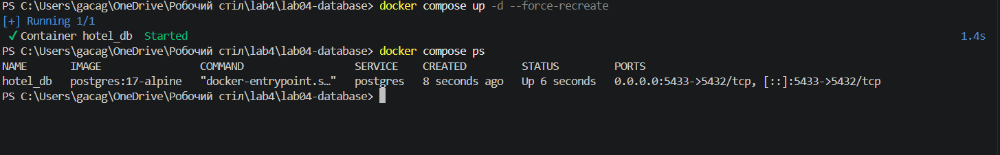

### Підготовка даних

На 15 бронюваннях з лабораторної №4 оптимізатор завжди обирає Sequential Scan, тому індекси не дали б ефекту. Скрипт `01_bulk_data.sql` додав великий обсяг тестових даних (50 000 гостей, 300 номерів, ~180 000 бронювань без перетину дат, оплати та послуги). На час вставки тригер `trg_payment_check` вимикався, після вставки увімкнено знову.

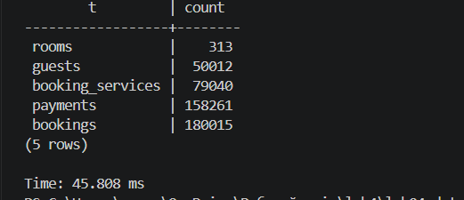

| Таблиця | Кількість рядків |
|---------|------------------|
| guests  | 50 012           |
| rooms   | 313              |
| bookings| 180 015          |

---

## 1. Результати аналізу продуктивності до та після оптимізації

Для аналізу використано `EXPLAIN (ANALYZE, BUFFERS)`. Кожен запит виконувався кілька разів, у таблиці наведено усталений результат. Скрипт: `02_explain.sql`.

### Запит A. Витрати гостя за прізвищем

```sql
SELECT g.guest_id, g.first_name, g.last_name,
       COUNT(b.booking_id) AS bookings_cnt,
       SUM(b.total_price)  AS spent
FROM guests g
JOIN bookings b ON b.guest_id = g.guest_id AND b.status <> 'cancelled'
WHERE g.last_name = 'Коваленко'
GROUP BY g.guest_id, g.first_name, g.last_name
ORDER BY spent DESC;
```

До індексу: `Seq Scan on guests` (відкинуто 49 511 рядків заради 501).

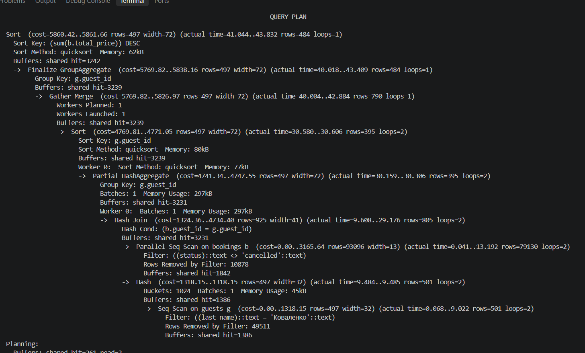
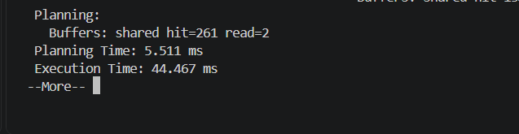

### Запит B. Оплати за березень 2025

```sql
SELECT date_trunc('day', p.paid_at) AS day, p.method,
       COUNT(*) AS payments_cnt, SUM(p.amount) AS total
FROM payments p
WHERE p.paid_at >= '2025-03-01' AND p.paid_at < '2025-04-01'
GROUP BY 1, 2
ORDER BY 1, 2;
```

До індексу: `Seq Scan on payments` (відкинуто 156 205 рядків заради 2 056).

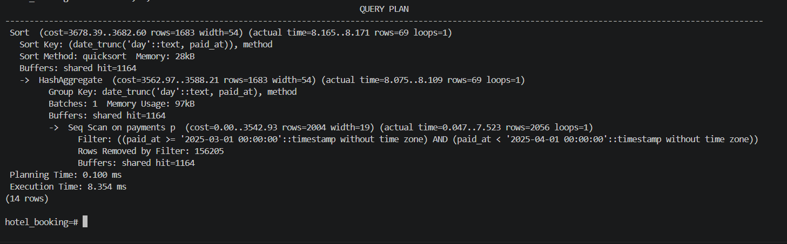

### Запит C. Виручка від послуги «Оренда велосипеда» по роках

```sql
SELECT date_trunc('year', b.check_in) AS year,
       COUNT(*) AS uses, SUM(bs.quantity) AS total_qty,
       SUM(bs.quantity * s.price) AS revenue
FROM services s
JOIN booking_services bs ON bs.service_id = s.service_id
JOIN bookings b          ON b.booking_id = bs.booking_id
WHERE s.name = 'Оренда велосипеда'
GROUP BY 1
ORDER BY 1;
```

До індексу: `Seq Scan on booking_services` (прочитано 79 040 рядків заради 2 301).

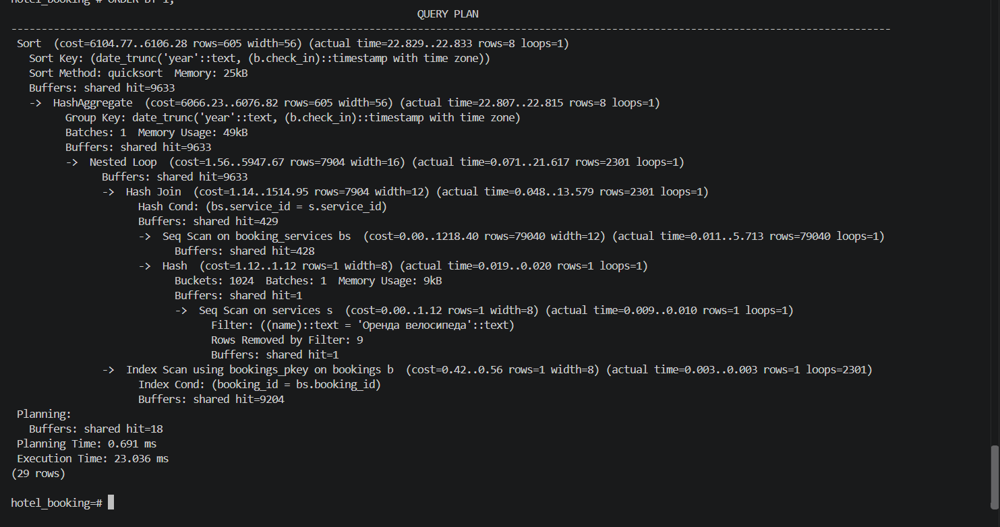

### Порівняння «до / після»

Покращення = (до − після) / до × 100 %.

|           Запит        |                Індекс           | До, мс | Після, мс | Покращення |
|------------------------|---------------------------------|--------|-----------|------------|
| A. Гість за прізвищем  | `idx_guests_last_name`          | 44.467 | 33.596    | ≈ 24 %     |
| B. Оплати за місяць    | `idx_payments_paid_at`          | 8.354  | 2.331     | ≈ 72 %     |
| C. Виручка від послуги | `idx_booking_services_service`  | 23.036 | 10.387    | ≈ 55 %     |

Плани після створення індексів:

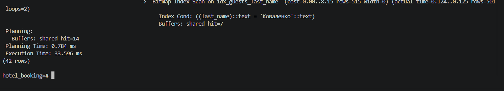
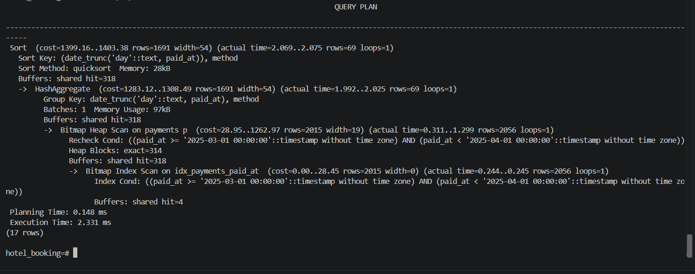
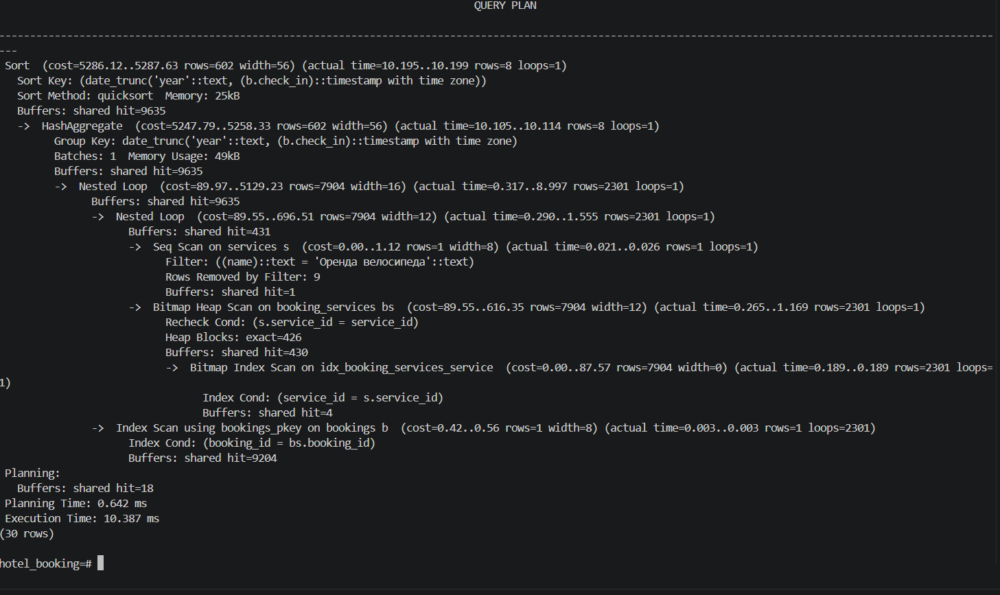

**Висновки по запитах:**
- **A:** `Seq Scan on guests` замінено на `Bitmap Index Scan`, пошук гостей прискорився з ~9 мс до менше ніж 1 мс. Загальний виграш найменший, бо основний час іде на `Parallel Seq Scan on bookings` (фільтр `status <> 'cancelled'` індекс не прискорює).
- **B:** фільтр обирає лише ~1,3 % рядків, тому індекс по діапазону дат дуже ефективний. Кількість прочитаних буферів зменшилась з 1164 до 318.
- **C:** замість повного читання `booking_services` використано індекс по `service_id`. Послуга рідкісна, тож вибірка мала. `Seq Scan on services` залишився, бо таблиця має 10 рядків.

---

## 2. Опис створених індексів з обґрунтуванням

Скрипт: `03_indexes.sql`.

```sql
CREATE INDEX idx_guests_last_name ON guests(last_name);
CREATE INDEX idx_payments_paid_at ON payments(paid_at);
CREATE INDEX idx_booking_services_service ON booking_services(service_id);
ANALYZE;
```

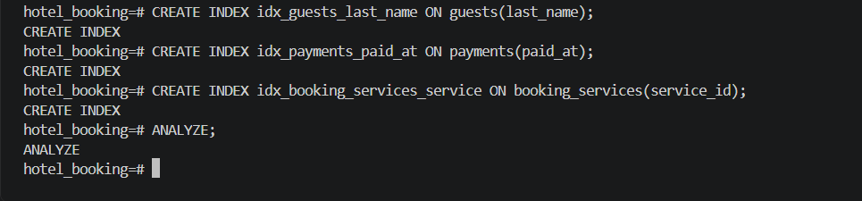

|             Індекс             |                      Обґрунтування                         |
|--------------------------------|------------------------------------------------------------|
| `idx_guests_last_name`         | пошук гостей за прізвищем (фільтр `WHERE last_name = ...`) |
| `idx_payments_paid_at`         | вибірки оплат за період (діапазонний фільтр по даті)       |
| `idx_booking_services_service` | первинний ключ `(booking_id, service_id)` не допомагає, бо `service_id` у ньому другий стовпець, а запити шукають за послугою                                                        |

### Часткові індекси (рівень 2)

Скрипт: `08_rules_partial.sql`.

```sql
-- лише активні бронювання
CREATE INDEX idx_bookings_active_dates ON bookings(check_in, check_out)
WHERE status IN ('confirmed', 'checked_in');

-- лише скасовані бронювання
CREATE INDEX idx_bookings_cancelled ON bookings(guest_id)
WHERE status = 'cancelled';
```

Запит з умовою на активні статуси використав частковий індекс (`Index Scan using idx_bookings_active_dates`, 0.049 мс).

|           Індекс              |        Що індексує         | Розмір  |
|-------------------------------|----------------------------|---------|
| `idx_bookings_dates` (повний) | усі бронювання (~180 тис.) | 1216 kB |
| `idx_bookings_active_dates`   | лише активні (~10 рядків)  | 16 kB   |
| `idx_bookings_cancelled`      | лише скасовані (~22 тис.)  | 472 kB  |

Частковий індекс по активних бронюваннях менший за повний приблизно у 76 разів і при цьому обслуговує запити, які цікавлять систему найчастіше.

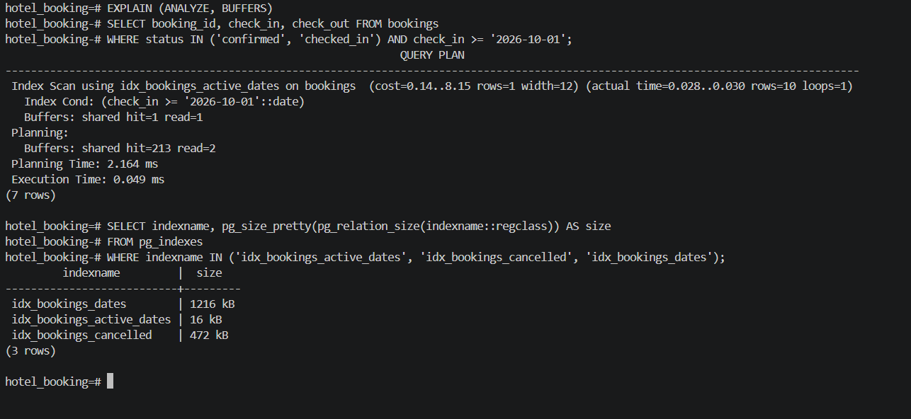

---

## 3. SQL-код створених представлень та тригерів

### 3.1. Представлення (рівень 1), файл `04_views.sql`

```sql
CREATE OR REPLACE VIEW v_active_bookings AS
SELECT b.booking_id,
       g.first_name || ' ' || g.last_name AS guest_name,
       r.room_number, rt.name AS room_type,
       b.check_in, b.check_out, b.status, b.total_price
FROM bookings b
JOIN guests g      ON g.guest_id = b.guest_id
JOIN rooms r       ON r.room_id = b.room_id
JOIN room_types rt ON rt.room_type_id = r.room_type_id
WHERE b.status IN ('confirmed', 'checked_in');

CREATE OR REPLACE VIEW v_room_type_performance AS
SELECT rt.room_type_id, rt.name AS room_type,
       COUNT(DISTINCT r.room_id) AS rooms_cnt,
       COUNT(b.booking_id) AS bookings_cnt,
       COUNT(b.booking_id) FILTER (WHERE b.status = 'cancelled') AS cancelled_cnt,
       ROUND(100.0 * COUNT(b.booking_id) FILTER (WHERE b.status = 'cancelled')
             / NULLIF(COUNT(b.booking_id), 0), 1) AS cancel_pct,
       COALESCE(SUM(b.total_price) FILTER (WHERE b.status <> 'cancelled'), 0) AS revenue
FROM room_types rt
LEFT JOIN rooms r    ON r.room_type_id = rt.room_type_id
LEFT JOIN bookings b ON b.room_id = r.room_id
GROUP BY rt.room_type_id, rt.name;
```

`v_active_bookings` замінює запит із трьома JOIN, `v_room_type_performance` дає зведення по типах номерів з агрегацією.

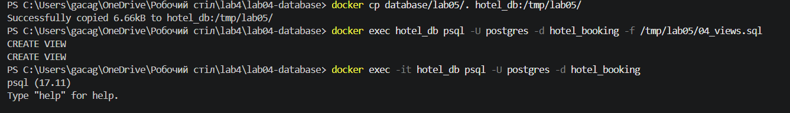
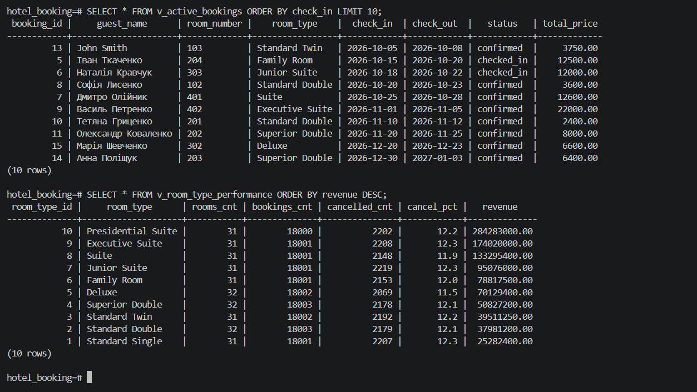

### 3.2. Представлення з правилом UPDATE (рівень 2), файл `08_rules_partial.sql`

```sql
CREATE OR REPLACE VIEW v_room_catalog AS
SELECT r.room_id, r.room_number, r.floor, r.status,
       rt.name AS room_type, rt.base_price
FROM rooms r
JOIN room_types rt ON rt.room_type_id = r.room_type_id;

CREATE OR REPLACE RULE v_room_catalog_update AS
ON UPDATE TO v_room_catalog
DO INSTEAD
    UPDATE rooms
    SET status = NEW.status, floor = NEW.floor
    WHERE room_id = OLD.room_id;
```

Представлення об'єднує дві таблиці, тому не оновлюється автоматично. Правило визначає, що UPDATE змінює лише `status` і `floor` таблиці `rooms`.

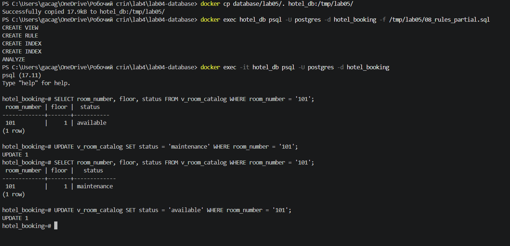

### 3.3. Таблиця `audit_log` і тригер логування (рівень 1), файл `05_audit.sql`

```sql
CREATE TABLE audit_log (
    log_id     SERIAL PRIMARY KEY,
    table_name VARCHAR(50)  NOT NULL,
    operation  VARCHAR(10)  NOT NULL CHECK (operation IN ('INSERT', 'UPDATE', 'DELETE')),
    record_id  INT,
    old_values JSONB,
    new_values JSONB,
    changed_by VARCHAR(100) NOT NULL DEFAULT current_user,
    changed_at TIMESTAMP    NOT NULL DEFAULT NOW()
);

CREATE OR REPLACE FUNCTION log_guest_changes() RETURNS TRIGGER AS $$
BEGIN
    IF TG_OP = 'INSERT' THEN
        INSERT INTO audit_log (table_name, operation, record_id, new_values)
        VALUES ('guests', 'INSERT', NEW.guest_id, to_jsonb(NEW));
    ELSIF TG_OP = 'UPDATE' THEN
        INSERT INTO audit_log (table_name, operation, record_id, old_values, new_values)
        VALUES ('guests', 'UPDATE', NEW.guest_id, to_jsonb(OLD), to_jsonb(NEW));
    END IF;
    RETURN NEW;
END;
$$ LANGUAGE plpgsql;

CREATE TRIGGER trg_guest_log
AFTER INSERT OR UPDATE ON guests
FOR EACH ROW EXECUTE FUNCTION log_guest_changes();
```

### 3.4. Валідація і повне логування (рівень 2), файл `07_level2.sql`

```sql
CREATE OR REPLACE FUNCTION validate_guest_data() RETURNS TRIGGER AS $$
BEGIN
    IF NEW.email !~ '^[A-Za-z0-9._%+-]+@[A-Za-z0-9.-]+\.[A-Za-z]{2,}$' THEN
        RAISE EXCEPTION 'Некоректний email: %', NEW.email USING ERRCODE = 'check_violation';
    END IF;
    IF NEW.phone IS NOT NULL AND NEW.phone !~ '^\+?[0-9\s\-()]{7,20}$' THEN
        RAISE EXCEPTION 'Некоректний телефон: %', NEW.phone USING ERRCODE = 'check_violation';
    END IF;
    IF NEW.birth_date IS NOT NULL AND NEW.birth_date < DATE '1900-01-01' THEN
        RAISE EXCEPTION 'Дата народження занадто рання: %', NEW.birth_date USING ERRCODE = 'check_violation';
    END IF;
    RETURN NEW;
END;
$$ LANGUAGE plpgsql;

CREATE TRIGGER trg_guest_validate
BEFORE INSERT OR UPDATE ON guests
FOR EACH ROW EXECUTE FUNCTION validate_guest_data();

-- універсальне логування INSERT / UPDATE / DELETE
-- назву ключового стовпця передають аргументом тригера (TG_ARGV[0])
CREATE OR REPLACE FUNCTION audit_all_changes() RETURNS TRIGGER AS $$
DECLARE
    v_id INT;
BEGIN
    IF TG_OP = 'DELETE' THEN
        v_id := (to_jsonb(OLD) ->> TG_ARGV[0])::INT;
        INSERT INTO audit_log (table_name, operation, record_id, old_values)
        VALUES (TG_TABLE_NAME, 'DELETE', v_id, to_jsonb(OLD));
        RETURN OLD;
    ELSIF TG_OP = 'UPDATE' THEN
        v_id := (to_jsonb(NEW) ->> TG_ARGV[0])::INT;
        INSERT INTO audit_log (table_name, operation, record_id, old_values, new_values)
        VALUES (TG_TABLE_NAME, 'UPDATE', v_id, to_jsonb(OLD), to_jsonb(NEW));
        RETURN NEW;
    ELSE
        v_id := (to_jsonb(NEW) ->> TG_ARGV[0])::INT;
        INSERT INTO audit_log (table_name, operation, record_id, new_values)
        VALUES (TG_TABLE_NAME, 'INSERT', v_id, to_jsonb(NEW));
        RETURN NEW;
    END IF;
END;
$$ LANGUAGE plpgsql;

-- простий тригер рівня 1 замінено повним, інакше INSERT/UPDATE логувалися б двічі
DROP TRIGGER trg_guest_log ON guests;

CREATE TRIGGER trg_guests_audit
AFTER INSERT OR UPDATE OR DELETE ON guests
FOR EACH ROW EXECUTE FUNCTION audit_all_changes('guest_id');

CREATE TRIGGER trg_rooms_audit
AFTER INSERT OR UPDATE OR DELETE ON rooms
FOR EACH ROW EXECUTE FUNCTION audit_all_changes('room_id');
```

### 3.5. Матеріалізоване представлення і каскадні тригери (рівень 3), файл `09_level3_triggers.sql`

```sql
CREATE MATERIALIZED VIEW mv_monthly_revenue AS
SELECT date_trunc('month', check_in)::date AS month,
       COUNT(*) AS bookings_cnt,
       SUM(total_price) AS revenue,
       ROUND(AVG(total_price), 2) AS avg_booking
FROM bookings
WHERE status <> 'cancelled'
GROUP BY 1;

CREATE UNIQUE INDEX idx_mv_monthly_revenue_month ON mv_monthly_revenue(month);

CREATE OR REPLACE FUNCTION refresh_mv_monthly_revenue() RETURNS TRIGGER AS $$
BEGIN
    REFRESH MATERIALIZED VIEW CONCURRENTLY mv_monthly_revenue;
    RETURN NULL;
END;
$$ LANGUAGE plpgsql SECURITY DEFINER SET search_path = public;

CREATE TRIGGER trg_refresh_mv_revenue
AFTER INSERT OR UPDATE OR DELETE ON bookings
FOR EACH STATEMENT EXECUTE FUNCTION refresh_mv_monthly_revenue();

-- каскад, крок 2: скасування бронювання видаляє його послуги
CREATE OR REPLACE FUNCTION cascade_booking_cancel() RETURNS TRIGGER AS $$
BEGIN
    DELETE FROM booking_services WHERE booking_id = NEW.booking_id;
    RETURN NULL;
END;
$$ LANGUAGE plpgsql SECURITY DEFINER SET search_path = public;

CREATE TRIGGER trg_booking_cancel_cascade
AFTER UPDATE OF status ON bookings
FOR EACH ROW
WHEN (NEW.status = 'cancelled' AND OLD.status IS DISTINCT FROM 'cancelled')
EXECUTE FUNCTION cascade_booking_cancel();

-- каскад, крок 3: зміни послуг потрапляють в audit_log
CREATE TRIGGER trg_booking_services_audit
AFTER INSERT OR UPDATE OR DELETE ON booking_services
FOR EACH ROW EXECUTE FUNCTION audit_all_changes('booking_id');

-- каскад, крок 1: номер на ремонті скасовує його майбутні бронювання
CREATE OR REPLACE FUNCTION cascade_room_maintenance() RETURNS TRIGGER AS $$
BEGIN
    UPDATE bookings SET status = 'cancelled'
    WHERE room_id = NEW.room_id AND status = 'confirmed' AND check_in > CURRENT_DATE;
    RETURN NULL;
END;
$$ LANGUAGE plpgsql SECURITY DEFINER SET search_path = public;

CREATE TRIGGER trg_room_maintenance_cascade
AFTER UPDATE OF status ON rooms
FOR EACH ROW
WHEN (NEW.status = 'maintenance' AND OLD.status IS DISTINCT FROM 'maintenance')
EXECUTE FUNCTION cascade_room_maintenance();
```

### 3.6. Процедура обслуговування (рівень 3), файл `11_maintenance.sql`

```sql
CREATE TABLE IF NOT EXISTS maintenance_log (
    log_id      SERIAL PRIMARY KEY,
    operation   TEXT NOT NULL,
    executed_at TIMESTAMP NOT NULL DEFAULT NOW()
);

CREATE OR REPLACE PROCEDURE maintain_database()
LANGUAGE plpgsql
AS $$
DECLARE
    tbl RECORD;
BEGIN
    ANALYZE;
    FOR tbl IN SELECT tablename FROM pg_tables WHERE schemaname = 'public'
    LOOP
        EXECUTE format('REINDEX TABLE public.%I', tbl.tablename);
        INSERT INTO maintenance_log (operation) VALUES ('REINDEX ' || tbl.tablename);
    END LOOP;
    INSERT INTO maintenance_log (operation) VALUES ('ANALYZE (вся база)');
    RAISE NOTICE 'Обслуговування бази завершено';
END;
$$;
```

`VACUUM` у процедуру не включено: він не може виконуватись усередині транзакції, його виконує фоновий `autovacuum`.

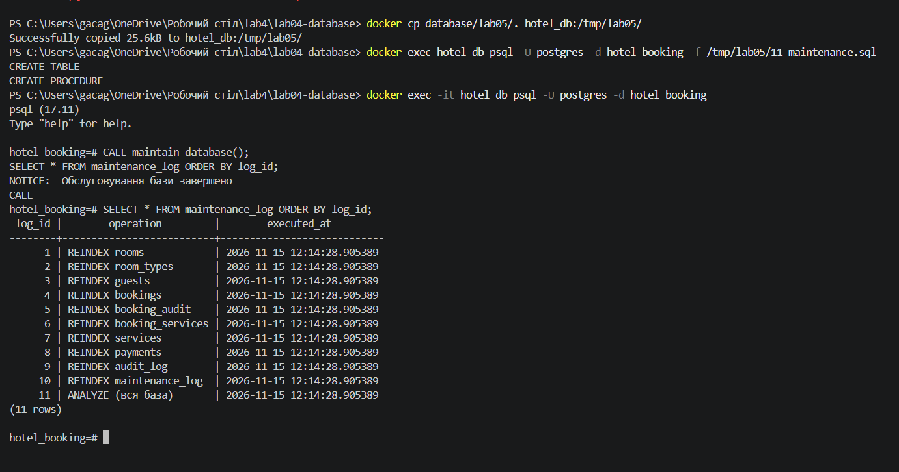

### 3.7. Моніторинг (рівень 3), файл `12_monitoring.sql`

```sql
CREATE EXTENSION IF NOT EXISTS pg_stat_statements;

CREATE OR REPLACE VIEW v_index_usage AS
SELECT s.relname AS table_name, s.indexrelname AS index_name,
       s.idx_scan AS scans, s.idx_tup_read AS tuples_read,
       pg_size_pretty(pg_relation_size(s.indexrelid)) AS size
FROM pg_stat_user_indexes s
ORDER BY s.idx_scan, pg_relation_size(s.indexrelid) DESC;

CREATE OR REPLACE VIEW v_slowest_queries AS
SELECT LEFT(regexp_replace(query, '\s+', ' ', 'g'), 80) AS query,
       calls,
       ROUND(total_exec_time::numeric, 1) AS total_ms,
       ROUND(mean_exec_time::numeric, 2)  AS mean_ms,
       ROUND(max_exec_time::numeric, 1)   AS max_ms
FROM pg_stat_statements
WHERE query NOT ILIKE '%pg_stat%'
ORDER BY mean_exec_time DESC
LIMIT 10;
```

`v_index_usage` показує, скільки разів використовувався кожен індекс (індекси з `scans = 0` є кандидатами на видалення, бо лише сповільнюють запис). `v_slowest_queries` показує найповільніші запити за середнім часом.

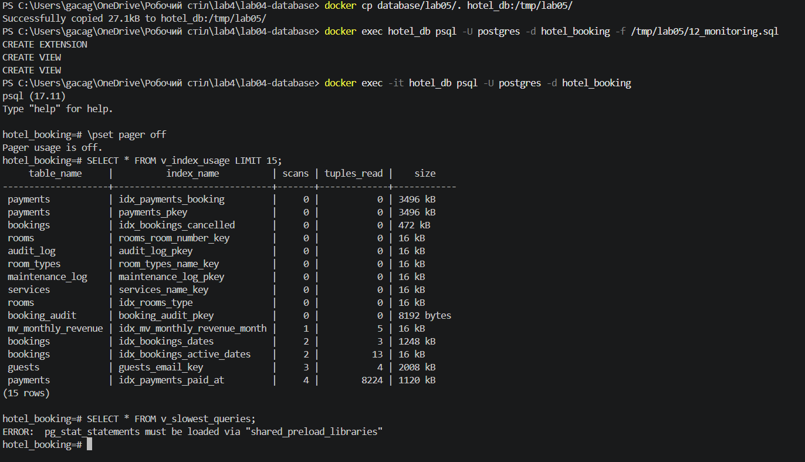

---

## 4. Перевірка роботи тригерів

### 4.1. Логування INSERT і UPDATE (рівень 1)

Тест виконано в транзакції з наступним `ROLLBACK`. У `audit_log` з'явилися записи `INSERT` і `UPDATE`, для `UPDATE` збережено нове значення телефону.

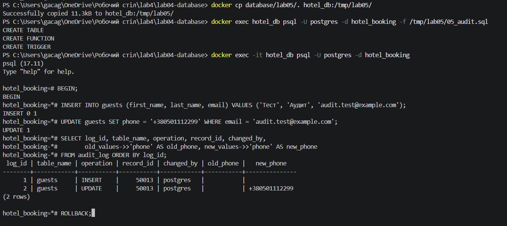

### 4.2. Валідація даних (рівень 2)

Некоректний email і телефон відхиляються функцією `validate_guest_data()` з повідомленнями українською.

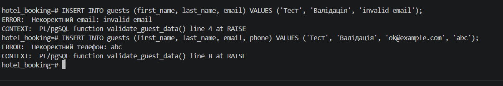

### 4.3. Повне логування INSERT / UPDATE / DELETE (рівень 2)

У `audit_log` збережено три операції над одним гостем. Для `UPDATE` є нове значення, для `DELETE` є старе.

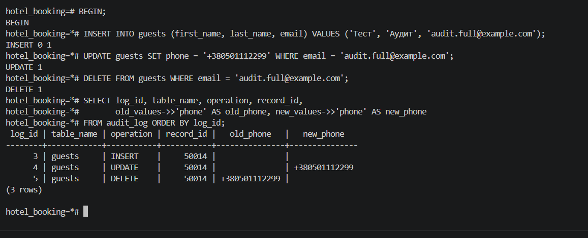

### 4.4. Матеріалізоване представлення з автооновленням (рівень 3)

Після `UPDATE bookings SET status = 'cancelled' WHERE booking_id = 14` без ручного `REFRESH` показник за грудень 2026 змінився:

|       | Бронювань |  Виручка  |
|-------|-----------|-----------|
| До    | 2         | 13 000.00 |
| Після | 1         | 6 600.00  |

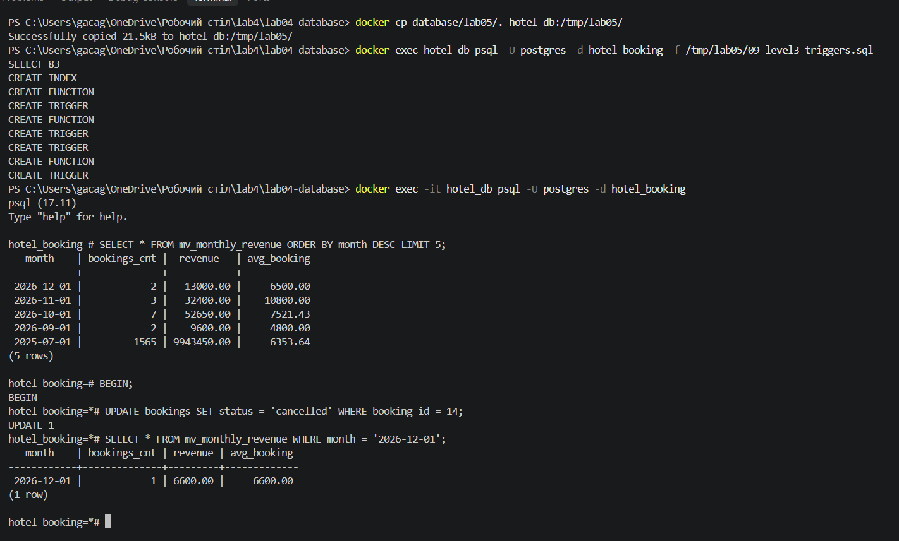

### 4.5. Каскадні тригери (рівень 3)

Єдиною дією було переведення номера 202 в статус `maintenance`. Далі спрацював ланцюжок:

1. `trg_room_maintenance_cascade`: бронювання 11 стало `cancelled`;
2. `trg_booking_cancel_cascade`: послуги бронювання 11 видалено (`services_left = 0`);
3. `trg_booking_services_audit`: видалення записано в `audit_log`;
4. тригер з лабораторної №4 записав зміну статусу в `booking_audit` (`confirmed → cancelled`).

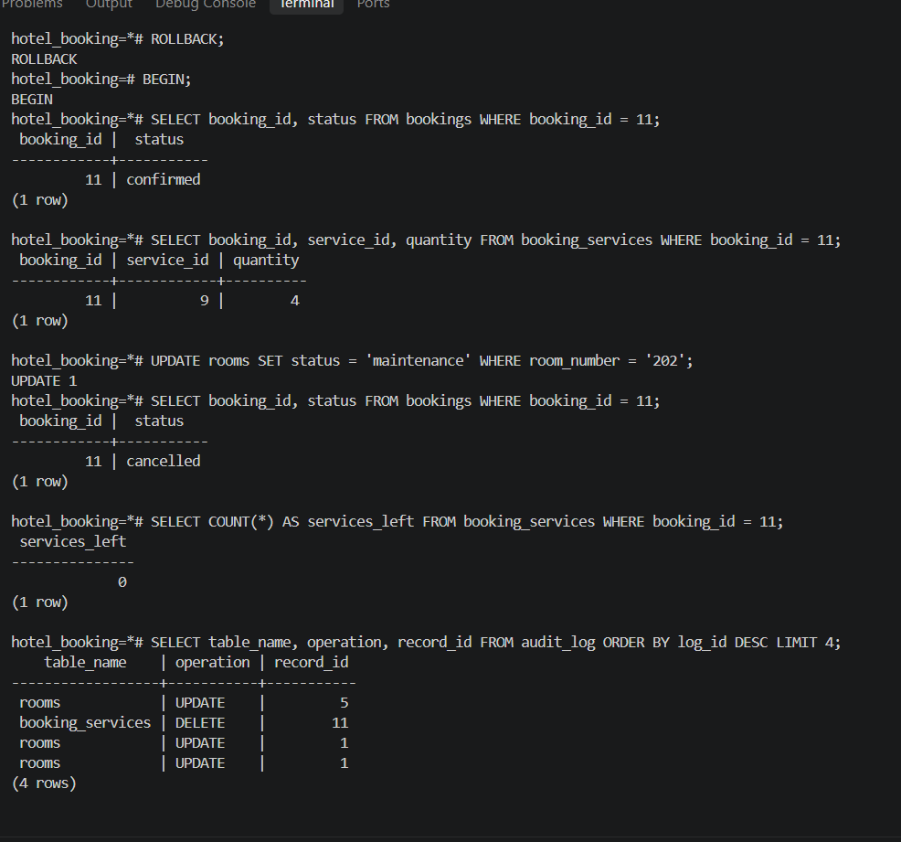
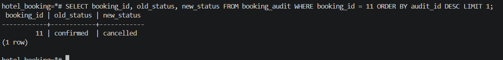

---

## 5. Система прав доступу

### 5.1. Користувач з обмеженими правами (рівень 1), файл `06_users.sql`

```sql
CREATE USER report_viewer WITH PASSWORD '********';
GRANT CONNECT ON DATABASE hotel_booking TO report_viewer;
GRANT USAGE ON SCHEMA public TO report_viewer;
GRANT SELECT ON room_types, rooms, services TO report_viewer;
GRANT SELECT (guest_id, first_name, last_name) ON guests TO report_viewer;
GRANT SELECT (booking_id, guest_id, room_id, check_in, check_out, guests_count, status)
    ON bookings TO report_viewer;
GRANT SELECT ON v_active_bookings, v_room_type_performance TO report_viewer;
```

Користувач не бачить контактних даних гостей (email, телефон, дата народження), сум бронювань, оплат та журналу аудиту, і не може змінювати дані.

|                    Запит                   |      Результат      |
|--------------------------------------------|---------------------|
| `SELECT * FROM v_room_type_performance`    | дозволено           |
| `SELECT first_name, last_name FROM guests` | дозволено           |
| `SELECT * FROM guests`                     | `permission denied` |
| `SELECT * FROM payments`                   | `permission denied` |
| `UPDATE rooms ...`                         | `permission denied` |
| `INSERT INTO services ...`                 | `permission denied` |
| `SELECT * FROM audit_log`                  | `permission denied` |

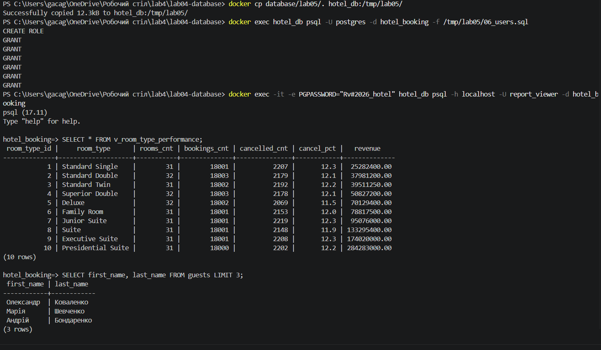
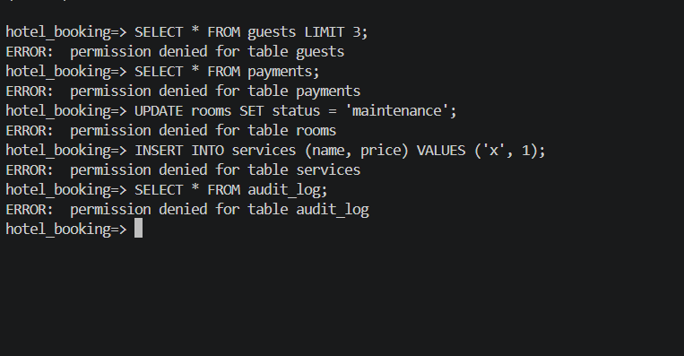

### 5.2. Ієрархія ролей (рівень 3), файл `10_roles.sql`

Групові ролі без входу, кожна наслідує права попередньої: `hotel_user` → `hotel_moderator` → `hotel_admin`.

| Роль                                | Користувач     |                            Права                                  |
|-------------------------------------|----------------|-------------------------------------------------------------------|
| `hotel_user` (звичайний користувач) | `guest_viewer` | перегляд довідників і представлень                                |
| `hotel_moderator` (модератор)       | `hotel_manager`| права `hotel_user` + зміна гостей, бронювань, оплат; без `DELETE` |
| `hotel_admin` (адміністратор)       | `hotel_owner`  | успадковує права модератора; повний доступ до всіх таблиць, включно з `DELETE` і `audit_log`                                                                                                     |

Результати перевірки:

|   Користувач    |               Запит              |     Результат       |
|-----------------|----------------------------------|---------------------|
| `guest_viewer`  | `SELECT COUNT(*) FROM rooms`     | 313, дозволено      |
| `guest_viewer`  | `SELECT COUNT(*) FROM guests`    | `permission denied` |
| `hotel_manager` | `SELECT COUNT(*) FROM guests`    | 50 012, дозволено   |
| `hotel_manager` | `DELETE FROM guests ...`         | `permission denied` |
| `hotel_owner`   | `SELECT COUNT(*) FROM audit_log` | дозволено           |

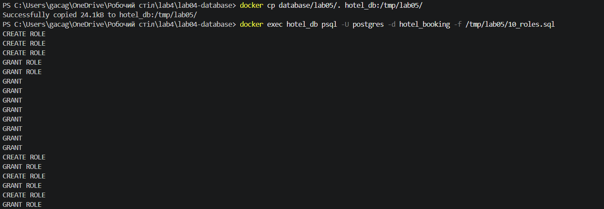
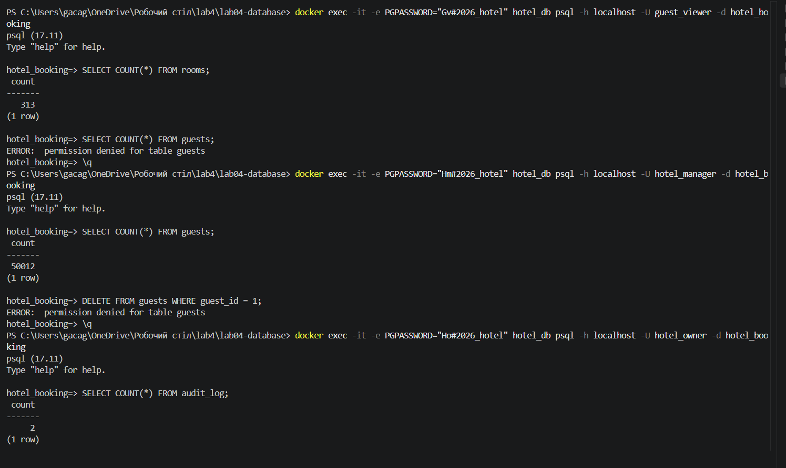

### 5.3. Резервне копіювання і відновлення (рівень 2)

```bash
# копія у custom-форматі
docker exec hotel_db pg_dump -U postgres -d hotel_booking -F c -f /tmp/hotel_backup.dump
docker cp hotel_db:/tmp/hotel_backup.dump database/hotel_backup.dump

# відновлення в окрему базу
docker exec hotel_db createdb -U postgres test_restore
docker exec hotel_db pg_restore -U postgres -d test_restore /tmp/hotel_backup.dump
```

Розмір копії 4.2 МБ. Після відновлення в `test_restore` є 50 012 гостей і 180 015 бронювань, що збігається з основною базою.

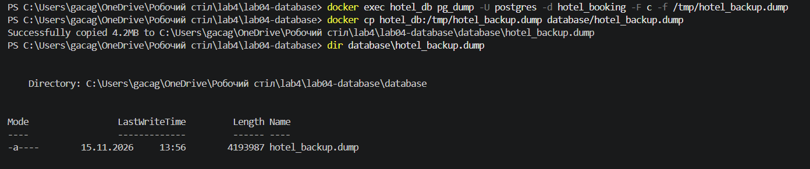
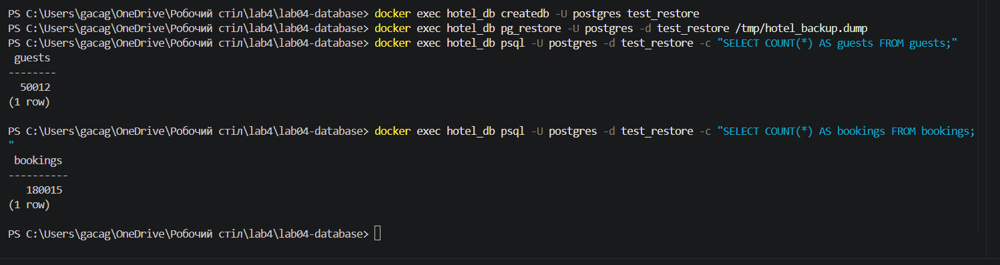

Файл `*.dump` додано у `.gitignore`, у репозиторій він не потрапляє.

---

## 6. Висновки та рекомендації

### Що виконано

| Рівень |                   Завдання                     |                      Результат                               |
|--------|------------------------------------------------|--------------------------------------------------------------|
|   1    | Аналіз 3 запитів через `EXPLAIN ANALYZE`       | виконано                                                     |
|   1    | 3 індекси з перевіркою покращення              | виконано, покращення 24-72 %                                 |
|   1    | 2 представлення                                | `v_active_bookings`, `v_room_type_performance`               |
|   1    | Тригер логування                               | `trg_guest_log`                                              |
|   1    | Користувач з обмеженими правами                | `report_viewer`                                              |
|   2    | Представлення з RULE                           | `v_room_catalog`                                             |
|   2    | Тригер валідації                               | `trg_guest_validate`                                         |
|   2    | Повний `audit_log`                             | `audit_all_changes` на `guests`, `rooms`, `booking_services` |
|   2    | Часткові індекси                               | 2 індекси, аналіз розміру і плану                            |
|   2    | `pg_dump` і відновлення                        | виконано, дані збігаються                                    |
|   3    | Матеріалізоване представлення з автооновленням | `mv_monthly_revenue`                                         |
|   3    | Каскадні тригери                               | ланцюжок із 3 тригерів                                       |
|   3    | Ієрархія ролей                                 | `hotel_user` → `hotel_moderator` → `hotel_admin`             |
|   3    | Процедура обслуговування                       | `maintain_database()`                                        |
|   3    | Моніторинг                                     | `v_index_usage`, `v_slowest_queries`                         |

### Висновки щодо продуктивності

- Ефект від індексів помітний лише на великому обсязі даних. На 15 бронюваннях з лабораторної №4 оптимізатор правильно обирав Sequential Scan, тому для аналізу таблиці було наповнено до 180 тисяч бронювань.
- Найбільше виграли запити, що вибирають малу частку рядків (B: 72 %, C: 55 %). У запиті A виграш лише 24 %, бо основний час іде на читання `bookings`, до якого індекс на `last_name` не відноситься.
- Частковий індекс по активних бронюваннях займає 16 kB проти 1216 kB повного, а запит виконується за соті частки мілісекунди.
- Кожен індекс сповільнює `INSERT`, `UPDATE`, `DELETE`, тому індекси створювались лише під реальні запити. Перевіряти їх корисність дозволяє `v_index_usage`.

### Рекомендації

1. Для запиту A додати складений індекс `bookings(guest_id, status)` або частковий індекс по `status <> 'cancelled'`, щоб прискорити й читання бронювань.
2. Матеріалізоване представлення оновлюється після кожного оператора зміни `bookings`. Для навчальної бази це прийнятно, у продуктивній системі краще оновлювати його за розкладом (наприклад, `pg_cron`) або підтримувати інкрементально.
3. Правила (`RULE`) вважаються застарілим механізмом, для нових проєктів краще використовувати тригери `INSTEAD OF`.
4. Паролі в навчальних скриптах слід замінити на власні й не зберігати у репозиторії.
5. Процедуру `maintain_database()` запускати за розкладом, а очищення мертвих кортежів залишити `autovacuum`.
6. Регулярно робити `pg_dump`, зберігати копії поза репозиторієм і періодично перевіряти відновлення.

### Труднощі

- Ефект від індексів не видно на малих таблицях, тому довелось генерувати великий обсяг даних і на час вставки вимикати тригер перевірки оплат.
- Простий тригер логування рівня 1 довелось замінити повним, інакше операції `INSERT` і `UPDATE` записувалися б в `audit_log` двічі.
- `VACUUM` і `REINDEX CONCURRENTLY` не можна виконувати всередині процедури, тому процедура обслуговування виконує `ANALYZE` і `REINDEX`.
